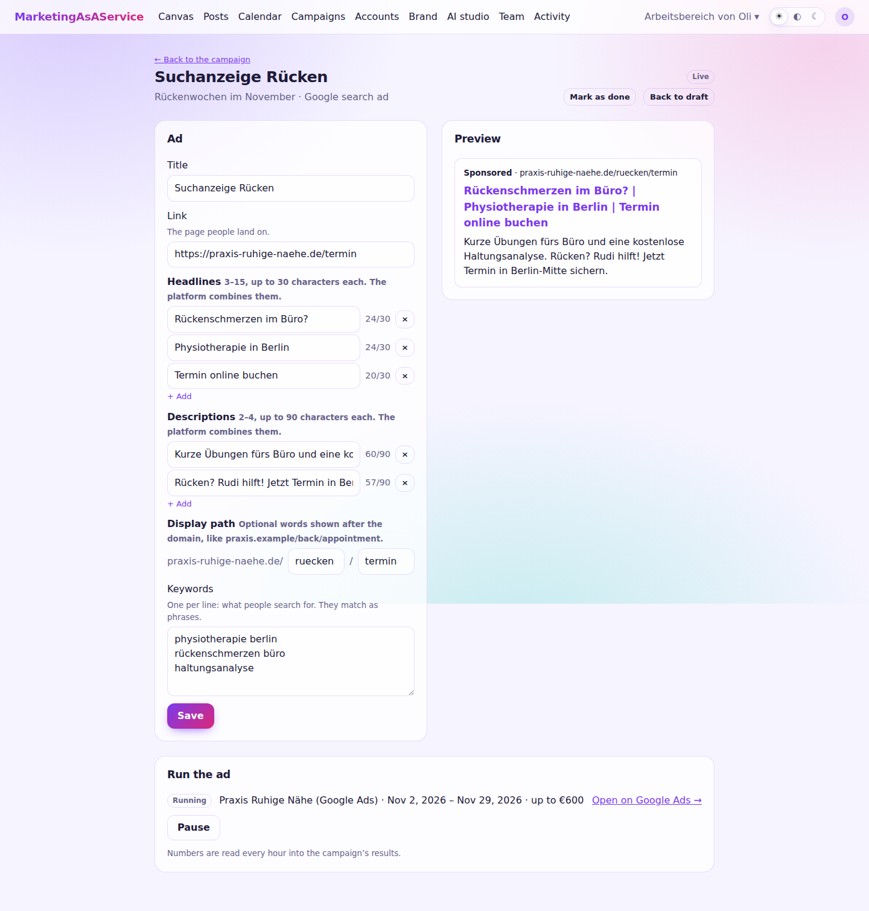

# Paid ads

Ad pieces run as paid campaigns on **Google Ads** and **Meta Ads**:

| Format | Platform | What is built there |
|---|---|---|
| Google search ad | Google Ads | A Search campaign with one responsive search ad and its keywords (phrase match) |
| YouTube video ad | Google Ads | A Demand Gen campaign showing a [video spot](spots.md) on YouTube only: in-stream, in-feed and Shorts |
| Facebook / Instagram ad | Meta Ads | A campaign with one ad set and one single-image ad on Facebook and Instagram |

MarketingAsAService never spends money on its own:

- Every campaign is created **paused**. Nothing runs until an owner or admin presses **Start**.
- The **budget** is a cap for the whole period, and the campaign has an **end date**.
  - **Google** gets a daily budget: the total divided by the days left. Google may spend up to twice that on a single day, but over a month not more than the daily budget times the days.
  - **Meta** gets a lifetime budget, which it never exceeds.
- The campaign's goal decides the optimization. *Get known* optimizes for reach on Meta. Everything else optimizes for clicks to the link: Maximize clicks on Google, link clicks on Meta. This works without conversion tracking.

## Writing an ad

Add a piece of type *Online ad* to a campaign and open it. The editor counts characters against each platform's limits and shows a preview:

| | Headlines | Descriptions | Also |
|---|---|---|---|
| Search ad | 3–15, up to 30 characters | 2–4, up to 90 characters | Display path (2 × 15 characters), keywords |
| Video ad | 1–5, up to 40 characters, plus 1–5 long headlines up to 90 | 1–5, up to 90 characters | A video spot of the campaign that is on YouTube (or a YouTube link); the square brand logo from the brand kit |
| Social ad | 1, up to 40 characters | The primary text, of which Meta shows the first 125 characters | A picture (square works on both networks) and a button |

The ad lists what it still lacks. Saving sends it back to *draft*; an owner or admin approves it.

## Running an ad

On an approved, complete ad, choose:
- the ad account
- the total budget, which defaults to what the campaign plans for this channel
- start and end dates (default: the campaign's)
- the countries
- for Google, the audience's language
- for Meta, the Facebook Page the ad runs as

**Create paused campaign** builds the campaign on the platform. **Open on …** shows it there, so you can check it. **Start** sets it running, after a confirmation that names the budget. **Pause** stops it.

Every hour the worker reads each campaign's daily numbers into the campaign's results, in the channel of the ad:

| Result | From |
|---|---|
| Reach | impressions |
| Clicks | clicks |
| Enquiries | conversions (Google) or leads and purchases (Meta) |
| Spend | cost |

When the ad account bills in another currency than the campaign, the spend appears in the note instead of the totals. After the end date the campaign counts as ended; its numbers are read for three more days, because platforms correct them late.

## Connecting ad accounts

Owners and admins connect ad accounts under **Campaigns → Ad accounts**. A Google sign-in brings every Google Ads account it can reach, except manager accounts. A Meta sign-in brings every active ad account and the Facebook Pages you manage. An account with a running campaign can only be removed after pausing it.

## Set up Google Ads

Google Ads needs the server's Google app (the one for [YouTube](../networks/google.md)) and a **developer token**. You apply for the token yourself, for your own Google Ads accounts.

1. In the Google Cloud project of `GOOGLE_CLIENT_ID`, enable the **Google Ads API**. Add `APP_URL/api/ads/google_ads/callback` as an authorized redirect URI.
2. In Google Ads, open a [manager account](https://ads.google.com/home/tools/manager-accounts/) and go to **Admin → API Center**. Apply for a developer token there.
   - The token starts with **test access**: it only works with test accounts, so you can try everything without spending.
   - For real campaigns, apply for **Basic access**. Describe the use honestly: you manage campaigns of your own business with a self-hosted tool.
3. Set `GOOGLE_ADS_DEVELOPER_TOKEN`. If your ad accounts sit under the manager account, also set `GOOGLE_ADS_LOGIN_CUSTOMER_ID` to its id, without dashes.
4. Restart web and worker. Then connect under **Campaigns → Ad accounts**.

The sign-in asks for the `https://www.googleapis.com/auth/adwords` scope, so the Google app needs it on its consent screen. While the app is in *Testing*, Google ends sign-ins after 7 days.

## Set up Meta Ads

Meta Ads uses the server's Facebook app (the one for [Facebook and Instagram](../networks/meta.md)).

1. In the [Meta app dashboard](https://developers.facebook.com/apps/), add the **Marketing API** product to the app. Add `APP_URL/api/ads/meta_ads/callback` as a valid OAuth redirect URI.
2. Set `ENABLE_META_ADS=true` and restart web and worker. Then connect under **Campaigns → Ad accounts**.

The sign-in asks for `ads_management`, `ads_read`, `business_management`, `pages_show_list` and `pages_read_engagement`.
- **Your own use:** with the app's *standard access*, these work for people with a role on the app and for the ad accounts they manage. That covers your own business without an app review.
- **Other people's ad accounts:** offering Meta Ads to them needs Meta's app review for *advanced access*.

Meta access lasts about 60 days; after that, connect the account again.
