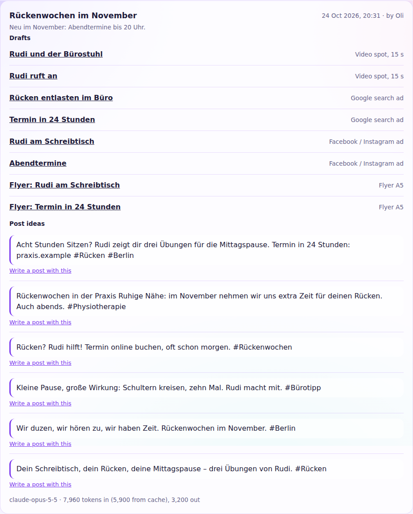

# AI studio

The AI studio lets Claude, Anthropic's AI model, write first drafts for a campaign: ads, print pieces, spot scripts and ideas for social posts, in your brand's voice and with its brand character. It is optional and separate from everything else. The app works the same without it, and you can always write every piece yourself.

Drafts are never published by the studio. Each one lands in the campaign as a piece marked **AI draft**, with status *draft*. You edit it in the same editor as any other piece, and an owner or admin approves it before it runs.

## What it drafts

| Choice | What you get |
|---|---|
| Google search ad | 10–15 headlines (30 characters), 2–4 descriptions (90), display path and 10–20 keywords |
| Facebook / Instagram ad | Headline (40), primary text (500, with the message in the first 125) and a button |
| YouTube video ad | Headlines, long headlines and descriptions; the video is the campaign's video spot from the same run, if there is one |
| Flyers, posters, newspaper ad | Headline, body and call to action sized for the format |
| Postcard and letter | The same, with a greeting that holds `{name}` for the recipient's name |
| Video, TV, cinema and radio spots | A script whose scenes add up to the spot's length, with voice-overs that fit at a calm pace, and directions for production |
| Ideas for social posts | Up to 280 characters each, so they fit every network; **Write a post with this** opens the composer with the text |

Per run you choose up to six of these, one to three drafts per format (each with a different angle), the language of the texts and optional notes, such as an offer, a date or what to avoid.

The studio fits every answer to the formats' limits: a headline that comes back too long is shortened at a word, and a spot's last scene takes up any difference in length. Ad links and QR codes point to the website from the brand kit.

## What Claude knows

Each request contains:

- the brand kit's texts: company, tagline, description, audience, tone of voice, do's and don'ts, website and the brand character (name, look, personality, voice, catchphrase and what it never does)
- the campaign: name, goal, audience, key message and dates
- your notes for this run

Pictures, contacts, recipient lists, results and budgets are not sent. Claude is told to use only these facts and to write a placeholder such as `[price]` where a piece needs something you did not give.

The better the brand kit, the better the drafts. A clear tone of voice and a brand character with a catchphrase make the biggest difference.

## Turn it on

1. Create an API key in the [Claude Console](https://platform.claude.com/) under **API keys**. Usage is billed to that account.
2. Set `ANTHROPIC_API_KEY` on the web container and restart it.
3. Optional: `AI_MODEL` picks another Claude model. The default is `claude-opus-5-5`.

**AI studio** then appears in the navigation, and each campaign links to it.

| Variable | What it does |
|---|---|
| `ANTHROPIC_API_KEY` | Turns the studio on |
| `AI_MODEL` | The Claude model to use (default `claude-opus-5-5`) |
| `ANTHROPIC_BASE_URL` | Anthropic's API address; only for tests against a fake server |

## Cost and limits

Each format is one request to Claude. The rules, brand and campaign are the same for every format of a run and are marked for Anthropic's prompt cache, so later formats of a run can read them from the cache at a lower price. Every run shows the tokens it used, so you can check them against Anthropic's prices.

A workspace can start 20 runs an hour.

## When Claude declines

Claude's safety checks can decline a request, even a harmless one. The studio has Anthropic's server-side fallback on: a declined request is retried on another Claude model, and the run shows which model wrote the drafts. See [Refusals and fallback](https://platform.claude.com/docs/en/build-with-claude/refusals-and-fallback). If a format still gets no draft, the run says why. Changing the notes or the brand kit usually helps.

## Privacy

The texts listed under [What Claude knows](#what-claude-knows) go to Anthropic. If people other than you use your server, name Anthropic as a processor in your privacy policy. See Anthropic's [commercial terms and privacy policy](https://www.anthropic.com/legal).
