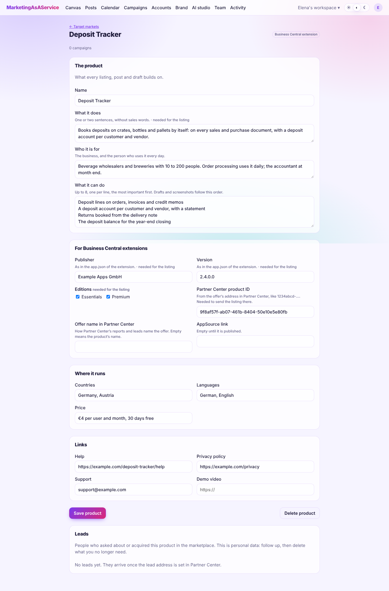
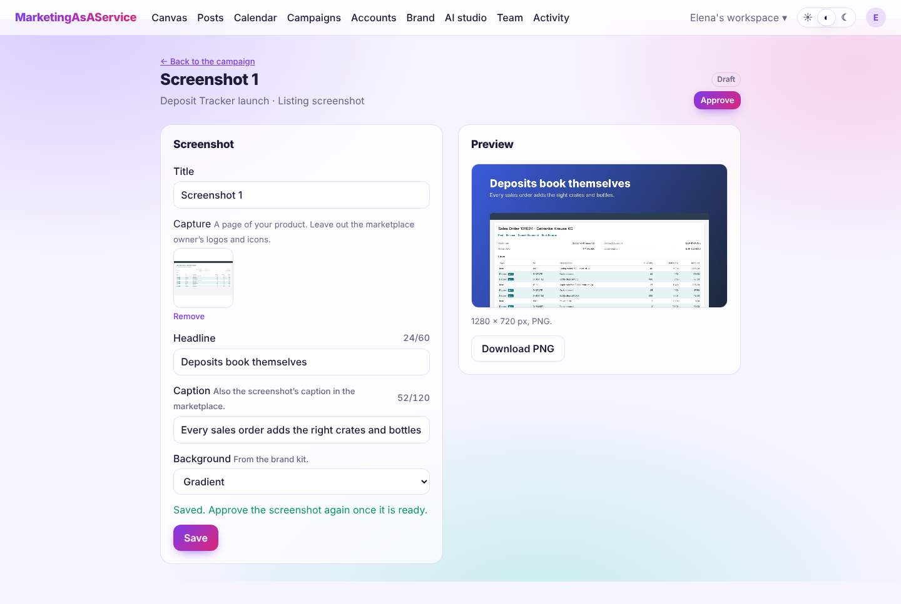
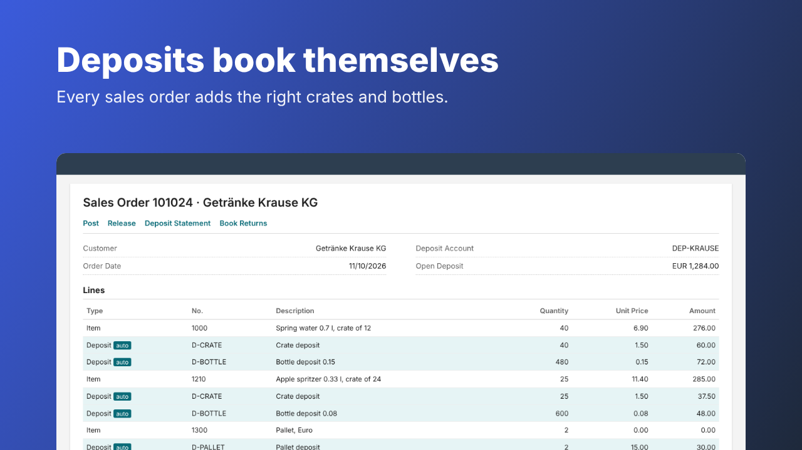
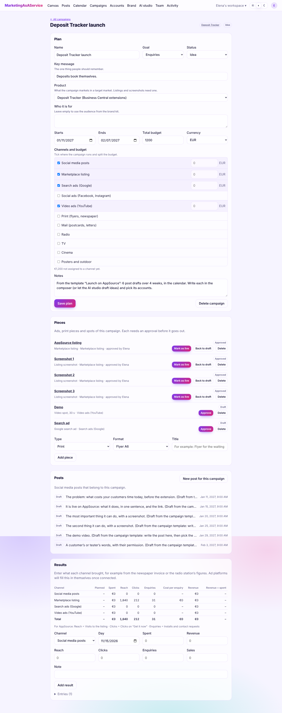
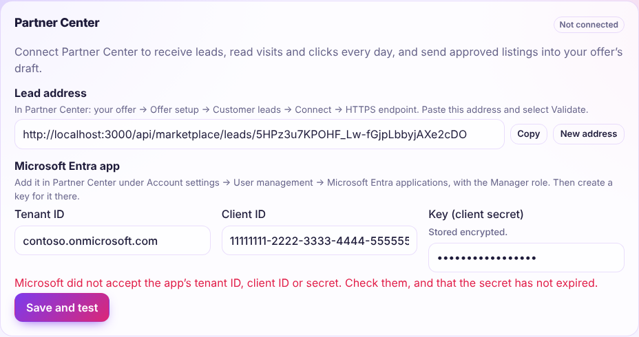
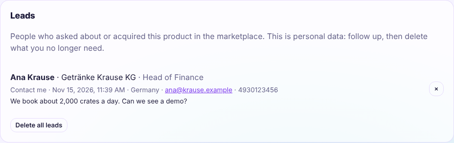

# MarketingApp4BusinessCentral

MarketingApp4BusinessCentral is MarketingAsAService set up for one job: marketing an extension for Microsoft Dynamics 365 Business Central. It is for the people who publish such an extension and have to get it found, tried and bought: the AppSource listing, the launch, every new version, and the numbers that show what worked.

It is a [target market](../markets.md): a plugin that a workspace installs, next to any other markets it sells in. The plugin holds everything that is particular to Business Central and AppSource (the profile fields, the listing's limits, Microsoft's rules, the templates, the AI guidance). The tools that use it are the same for every market and build on what is already there: the [brand kit](index.md#brand-kit), [campaigns](index.md#campaigns) with their approval, posts, ads and the [AI studio](ai-studio.md).

## Getting started

1. **Brand → Target markets → Install** next to *Business Central extensions* (owners and admins).
2. **Add product: Business Central extension** and fill in its profile, with the product ID and offer name from Partner Center.
3. **Connect Partner Center** on the same page: an Entra app for numbers and sending the listing, and the lead address for leads ([Partner Center](#partner-center)).
4. **Campaigns → New campaign**: pick the product and *Launch on AppSource*. The campaign comes with the listing, three screenshots, a demo spot, a search ad and six post drafts in the calendar.
5. Fill in the screenshots and the listing until their checks pass, then approve them and **Send to Partner Center**. Upload the screenshots and documents there and publish.

The [checklist](#your-checklist) at the end lists every step, yours and Microsoft's.

| | What you get |
|---|---|
| **Extension profile** | What the extension does, who it is for, what it can do, where it runs, and its links. Every listing, post and draft builds on it. |
| **AppSource listing** | The listing as a piece of a campaign: its texts with Microsoft's limits, keywords, videos and documents, checked before approval, then copied into Partner Center. |
| **Listing screenshots** | A capture of your extension becomes a 1280 × 720 PNG with a headline and a caption in the brand's colors. |
| **Campaign templates** | Launch on AppSource, a new version, ready for the release wave, an event, a customer story. |
| **Drafts by the AI studio** | Listing texts, and every other draft, written from the extension's profile and Microsoft's rules. |
| **Partner Center** | Leads arrive by themselves, visits and clicks are read every day, and an approved listing goes into the offer's draft with one click. |
| **Results** | Visits to the listing, clicks and leads per day in the campaign's results, next to ads and posts. |

The pictures below are captures of the app, with an example extension.

### The extension profile

A workspace can hold several extensions, since a publisher often has more than one. A campaign belongs to one of them: pick it in the campaign's plan, or when you start the campaign.

Every product has the common fields of a profile. The Business Central market adds publisher, version, editions and the AppSource link.

- **The extension:** name, publisher and version (the same as in the app's `app.json`, because the listing has to match), and the AppSource link
- **What it does** and **who it is for:** the business and the person who uses it every day
- **What it can do:** up to eight things, one per line, the most important first
- **Where it runs:** editions (Essentials, Premium), countries, languages, and the price
- **Links:** help, privacy policy, support, demo video
- **Partner Center:** the offer's product ID (from its address in Partner Center, needed to send the listing) and its name as Partner Center's reports and leads spell it (empty means the product's name)

What it does, publisher, version and editions are needed before a listing can be approved.

### The AppSource listing

The listing is a piece like an ad or a flyer: it starts as a draft, an owner or admin approves it, and changing it sends it back to draft. Its channel is **Marketplace listing**. The editor counts characters while you type; *Before it can be approved* lists what is still missing, and approval is refused until nothing is.

| Field | Microsoft's rule | Checked here |
|---|---|---|
| Name | up to 200 characters, no emojis; ™ and © are fine | length, emojis |
| Search results summary | up to 100 characters | length |
| Description | up to 5,000 characters, simple HTML allowed | length |
| Search keywords | up to 3 | count |
| Screenshots | 3 to 5, PNG, 1280 × 720 pixels, each with a caption; no Microsoft logos or icons | count, caption, size |
| Videos | up to 4, as `https://www.youtube.com/watch?v=…` or `https://vimeo.com/…` links, each with a 1280 × 720 PNG thumbnail | count |
| Products your app works with | up to 3 | no, entered in Partner Center |
| Help and support links | must be different pages | no, a rule to check |
| Documents | 1 to 3 PDFs | count |
| Logo | PNG, from 216 × 216 to 350 × 350 pixels | no, entered in Partner Center |
| Categories and industries | a primary and a secondary category with up to 4 subcategories; up to 2 industries | no, entered in Partner Center |

These are Microsoft's rules, checked on Microsoft's pages on 15 November 2026 (the listing page was last updated on 29 July 2025, the marketing checklist on 26 September 2023): [listing details](https://learn.microsoft.com/en-us/partner-center/marketplace-offers/dynamics-365-business-central-offer-listing), [marketing validation checklist](https://learn.microsoft.com/en-us/dynamics365/business-central/dev-itpro/developer/readiness/readiness-checklist-marketing) and [marketing artifacts](https://learn.microsoft.com/en-us/dynamics365/business-central/dev-itpro/developer/readiness/readiness-checklist-g-marketingartifacts-logo-video-docs-screenshots). They change; the texts, counts and screenshot size live in the market's file (`packages/core/src/markets/business-central.ts`) and get checked against these pages when they do.

What a computer cannot check is listed under *Check these yourself*: name, publisher and version match the extension's `app.json`; the description names the supported editions, countries and languages, matching the markets of the offer; no Microsoft logos or icons; one language only (a description in another language than English starts with "This application is available only in [language]."); screenshots of the newest Business Central UI with realistic demo data; video links and thumbnails; different help and support pages; and what is entered only in Partner Center.

The listing's screenshots are the campaign's *Listing screenshot* pieces. Once the listing is approved, **Send to Partner Center** writes its texts into the offer's draft (see [Partner Center](#partner-center)); *For AppSource* also copies each text, for pasting by hand. Microsoft validates every change of the marketing texts by hand, which takes its own time.

### Listing screenshots

Upload a capture of a page of your extension, write a headline and a caption, and pick a background from the brand kit: a gradient of the main and second color, the main color, dark or light. The preview is the picture itself; **Download PNG** saves it in the size AppSource asks for. A screenshot needs a capture and a caption before it can be approved. Leave out Microsoft's logos and icons in the capture: the checklist does not allow them.

The downloaded picture:

### Campaign templates

| Template | When | What it sets up |
|---|---|---|
| Launch on AppSource | The extension goes live | The listing, three screenshots, a 30-second demo spot, a search ad; six posts over four weeks |
| New version | A release with something people asked for | An updated listing and a screenshot of what is new; three posts over two weeks |
| Ready for the release wave | Every April and October, when Business Central's new version arrives | An updated listing; one post |
| Event | A conference or a webinar | A flyer for the booth; four posts over three weeks |
| Customer story | A customer agrees to be named | A social ad with the customer's quote; three posts over three weeks |

A template sets the goal and the channels, adds its pieces as drafts, and puts its posts as drafts into the calendar, spread over its weeks from the campaign's start (or tomorrow), each with its topic, such as "The problem: what costs your customers time today". Drafts have no accounts yet: write each in the composer, or let the AI studio draft ideas, then pick its accounts and schedule it. Everything can be changed or removed.

### Drafts by the AI studio

With the [AI studio](ai-studio.md) set up (`ANTHROPIC_API_KEY`), a campaign with a product offers **Marketplace → Marketplace listing**: Claude drafts the listing's texts and keywords within the market's limits. Every draft of such a campaign, ads and posts included, is written from the product's profile and the market's guidance: the platform is called "Microsoft Dynamics 365 Business Central" the first time and "Business Central" after that, never "BC"; nothing suggests that Microsoft made or endorses the extension; and the marketplace's rules apply. Drafts need the same approval as any piece.

To check the studio with your key before people use it, run `npm run studio:check` on the server or a clone of the repository. It drafts one AppSource listing for an example product through the studio's own code, prints the texts with their lengths, and ends with "The draft is within AppSource's limits", or says what went wrong. It costs a few cents and stores nothing.

### Results

The campaign's results take the marketplace like any channel. For AppSource, reach counts visits to the listing, clicks count "Get it now", "Contact me" and "Free trial", and leads count installs and contact requests; the results table says so under it. With Partner Center connected, these numbers book themselves; without it, enter them per day from Partner Center's reports.

Numbers and leads of a day count for the product's campaign whose dates cover that day (the latest to start), or for an undated campaign marked *Running*.

## Partner Center

Partner Center is where Microsoft's publishers manage their offers. Connected under **Brand → Target markets → Partner Center**, MarketingAsAService uses three of its interfaces.

| | How | Needs |
|---|---|---|
| **Leads** | Partner Center posts every lead to the workspace's lead address. Leads are kept on the product's page, with name, company, contact details and message; installs ("Acquired") and contact requests ("Contact me") count as leads in the campaign's results. | The lead address set as the offer's HTTPS endpoint |
| **Numbers** | The worker schedules Microsoft's daily *Marketplace Insights* report once, then reads its newest run every six hours: page visits, and clicks on *Get it now*, *Contact me* and *Free trial*, per day and offer. A day read again replaces what was booked for it. | The Entra app |
| **Sending the listing** | **Send to Partner Center** on an approved listing writes its name, summary, description, keywords and the product's help and privacy links into the offer's draft through Microsoft's Product Ingestion API. Publishing stays with you in Partner Center, where you also upload screenshots, documents and the logo. | The Entra app, and the product ID in the product's profile |

The Entra app is one app registration that Partner Center knows, with the Manager role. Its key is stored encrypted, like every credential here. **Save and test** checks it with Microsoft before saving. The lead address contains a secret: anyone with it can send leads, so only owners and admins see it, and **New address** replaces it.

Microsoft's Product Ingestion API supports Business Central offers in public preview. Endpoints and formats follow Microsoft's pages as of 15 November 2026: [Product Ingestion API](https://learn.microsoft.com/en-us/partner-center/marketplace-offers/product-ingestion-api), [Business Central offers](https://learn.microsoft.com/en-us/partner-center/marketplace-offers/product-ingestion-api-dynamics-365-business-central), [analytics API](https://learn.microsoft.com/en-us/partner-center/insights/analytics-make-your-first-api-call) and [its system queries](https://learn.microsoft.com/en-us/partner-center/insights/analytics-system-queries), and [leads to an HTTPS endpoint](https://learn.microsoft.com/en-us/partner-center/marketplace-offers/partner-center-portal/commercial-marketplace-lead-management-instructions-https). The code is in `packages/core/src/partner-center.ts` and `marketplace.ts`, tested against a stand-in for Microsoft; no real Partner Center account was used.

The server needs to reach `login.microsoftonline.com`, `graph.microsoft.com`, `api.partnercenter.microsoft.com` and Microsoft's report storage, and Microsoft needs to reach the server's `APP_URL` over https for the leads.

## Decisions

| Decision | Why | Revisit when |
|---|---|---|
| A target market plugin, not an app of its own | Brand kit, campaigns, approval, posts, ads and the AI studio are all needed and already there; what is particular to Business Central fits in one file | It should be offered on its own |
| Several markets per workspace | A publisher can sell in more than one marketplace; another market is a file, not new code | — |
| Installed per workspace, none at first | A physio practice and a software publisher can share a server without seeing each other's tools | — |
| For any extension | The profile holds what differs between extensions; nothing is written for one product | — |
| The listing's texts go into the offer's draft; publishing stays in Partner Center | Microsoft validates by hand anyway, and a person should see the draft before it goes live | The ingestion API leaves preview and screenshots should go up too |
| Screenshots are drawn in the browser | Exactly the size the market asks for, with the brand's colors, and no image library on the server | Pictures need fonts the browser does not have |
| Template posts are drafts without accounts | The topic is known before anyone writes the post; accounts are picked when it is written | — |
| Numbers from Microsoft's daily report, leads by Microsoft's push | The two interfaces Microsoft documents for this; no scraping | — |
| Microsoft's limits in one place, with their source | They change, and a wrong limit fails validation weeks later | — |

MarketingApp4BusinessCentral is not a Microsoft product. Microsoft, Dynamics 365, Business Central and AppSource are trademarks of the Microsoft group of companies.

## Where it lives

- `packages/core/src/markets/business-central.ts`: the market itself, as data
- `packages/core/src/market.ts`, `plugins.ts`: the target market format, its checks, `listingProblems`, and installing markets per workspace (see [target markets](../markets.md#for-developers))
- `packages/core/src/products.ts`: products and their profiles, and `checkListing`, which approval of a listing waits for
- `packages/core/src/templates.ts`: starting a campaign from a market's template
- `packages/core/src/campaigns.ts`, `marketing.ts`: the marketplace channel and the listing and screenshot pieces; `studio.ts`: the product in the AI studio's prompt and listing drafts
- `packages/core/src/partner-center.ts`, `marketplace.ts`: the Partner Center client, leads, the daily numbers and sending the listing; `apps/web/app/api/marketplace/leads/[token]/route.ts` takes the leads; the worker reads the numbers
- `packages/core/scripts/studio-check.ts`: the live check of the AI studio (`npm run studio:check`)
- `packages/db`: `products`, `campaigns.product_id`, the piece kinds `listing` and `screenshot` (migration `0020_products`), `marketplace_connections` and `marketplace_leads` (`0021_marketplace_connections`)
- `apps/web`: **Brand → Target markets** and the product pages (`app/(app)/brand/`), the listing and screenshot editors (`components/listing-editor.tsx`), the template picker; texts in `messages/markets.ts` and `messages/listing.ts`, in English and German

## Build order

0. [x] **Target market plugins.** The format with its checks, storage per workspace, and the built-in market `business-central`.
1. [x] **Markets and profiles in the app.** Install markets under Brand (built-in or from a file), owners and admins only; products with their profile; a campaign's product.
2. [x] **AppSource listing.** The channel and the piece with limits, checks and approval; copy the texts.
3. [x] **Listing screenshots.** Capture, headline, caption and background, drawn at 1280 × 720.
4. [x] **Campaign templates.**
5. [x] **Drafts by the AI studio.** Listing drafts, and the product and Microsoft's rules in every prompt.
6. [x] **Results.** The marketplace channel, with the market's meaning of reach, clicks and leads.
7. [x] **Partner Center.** Leads, daily numbers, and sending the listing's texts; post drafts from templates; the live check of the AI studio.
8. [ ] **Next.** Upload screenshots, documents and the logo through the ingestion API; the listing's categories and products it works with.

## Your checklist

What has to happen once, in this order. The parts in Microsoft's tools are yours; MarketingAsAService cannot do them for you.

**Server**

- [ ] Deploy the new version. The migrations `0019` to `0021` run with it (`npm run db:migrate` without Docker).
- [ ] `APP_URL` is the server's public https address, so Microsoft can reach the lead address.

**Business Central in MarketingAsAService**

- [ ] Brand → Target markets → **Install** *Business Central extensions*.
- [ ] **Add product**: name, what it does, who it is for, what it can do; publisher and version exactly as in `app.json`; editions; countries and languages; help, privacy and support links (help and support on different pages).
- [ ] From Partner Center: the offer's **product ID** (the GUID in the offer's address) and, if it differs from the product's name, the **offer name**.

**Partner Center app (for numbers and sending)**

- [ ] Partner Center → Account settings → User management → **Microsoft Entra applications**: create or add an app and give it the **Manager** role.
- [ ] On the app's page there: copy the **Tenant ID** and **Client ID**, select **Add new key** and copy the key (it is shown only once; note when it expires).
- [ ] MarketingAsAService → Brand → Target markets → Partner Center: paste the three, **Save and test**.
- [ ] **Read numbers now** once; the first numbers arrive within a day.

**Leads**

- [ ] Copy the **lead address** from Brand → Target markets → Partner Center.
- [ ] Partner Center → your offer → Offer setup → **Customer leads** → Connect → **HTTPS endpoint**: paste it, **OK**, then **Validate**.
- [ ] The test lead shows on the product's page in MarketingAsAService; delete it there.

**The listing**

- [ ] Campaigns → New campaign → your product → *Launch on AppSource*, with start and end dates.
- [ ] Three to five captures of the newest Business Central UI with realistic demo data, no Microsoft logos or icons; one screenshot piece each, with headline and caption; approve them.
- [ ] Fill in the listing until *Before it can be approved* has nothing left; go through *Check these yourself*; approve it.
- [ ] **Send to Partner Center**, then in Partner Center: upload the downloaded screenshots, 1 to 3 PDFs, the logo (PNG, 216 × 216 to 350 × 350), video links and thumbnails; choose categories, industries and up to three products it works with; **Review and publish** to preview, then live.

**AI studio**

- [ ] An Anthropic API key with a monthly spend limit in the Claude Console; `ANTHROPIC_API_KEY` on web and worker; restart them.
- [ ] Run `npm run studio:check` once with the key. It ends with "The draft is within AppSource's limits".

**Later**

- [ ] Work through the post drafts in the calendar: write each (or let the AI studio draft ideas), pick its accounts and schedule it.
- [ ] Follow up on leads within a day, then delete what you no longer need: they are personal data. The built-in privacy page lists them; if you use your own (`LEGAL_PRIVACY_URL`), add them there.
- [ ] Renew the Entra app's key before it expires, and save it again here.
- [ ] Check Microsoft's limits when they change, at the latest with each release wave in April and October; they are in `packages/core/src/markets/business-central.ts` with links to Microsoft's pages.
