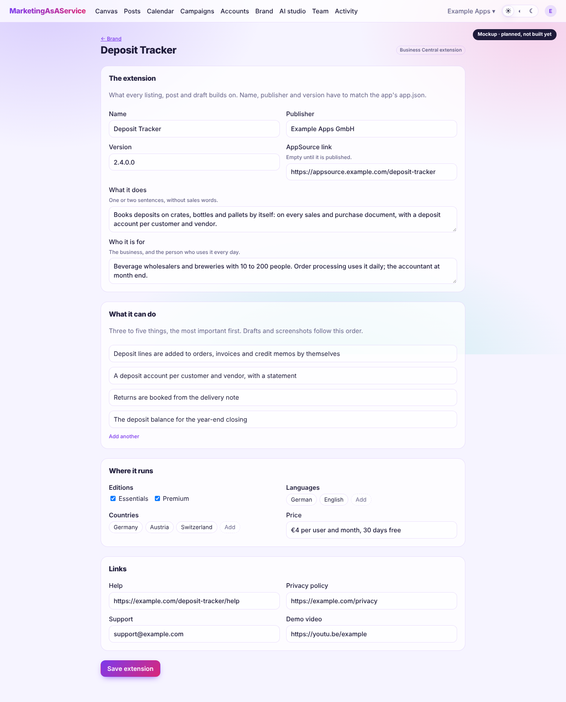
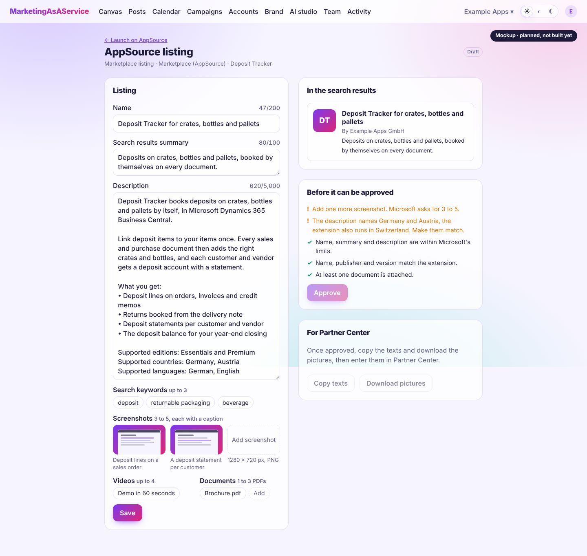
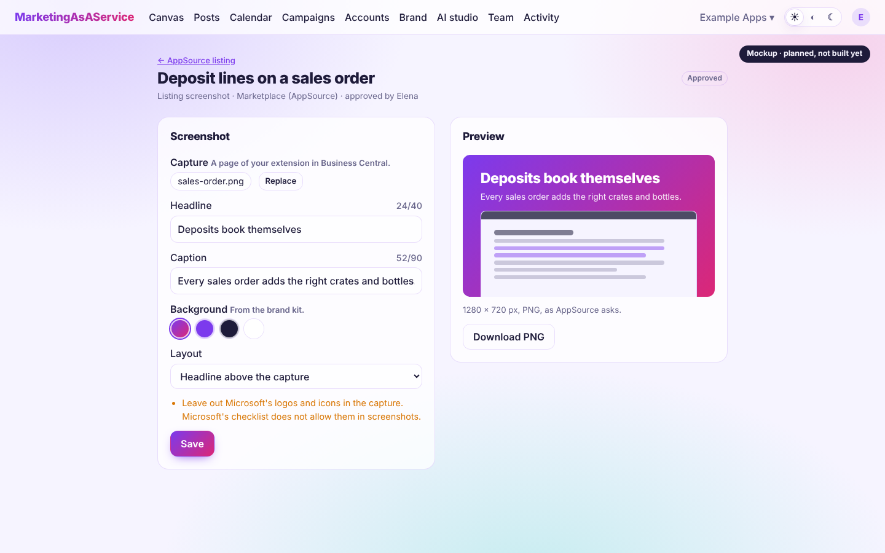
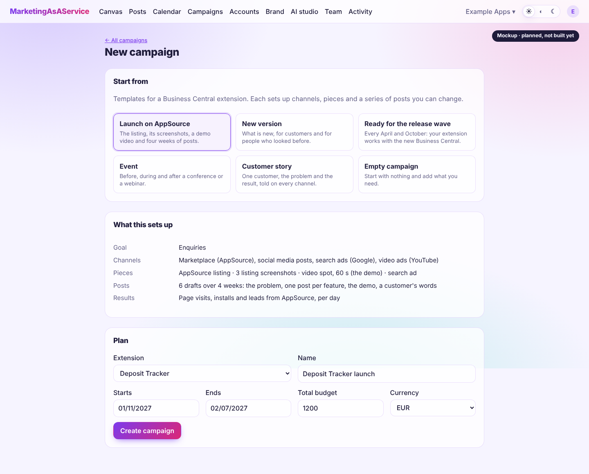
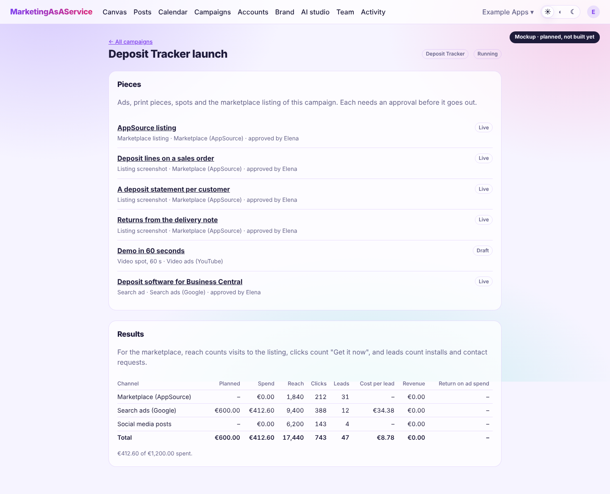

# MarketingApp4BusinessCentral

MarketingApp4BusinessCentral is MarketingAsAService set up for one job: marketing an extension for Microsoft Dynamics 365 Business Central. It is for the people who publish such an extension and have to get it found, tried and bought: the AppSource listing, the launch, every new version, and the numbers that show what worked.

It is a part of the platform, turned on per workspace. Everything else stays as it is: the [brand kit](index.md#brand-kit), [campaigns](index.md#campaigns) with their approval, posts, ads and the [AI studio](ai-studio.md).

> **Status: defined, not built yet.** This page says what it adds and in which order it gets built. The pictures are mockups in the look of the app, not captures of working screens.

## What it adds

| | What you get | Step |
|---|---|---|
| **Extension profile** | What the extension does, who it is for, what it can do, where it runs, and its links. Every listing, post and draft builds on it. | 1 |
| **AppSource listing** | The listing as a piece of a campaign: its texts with Microsoft's limits, screenshots, videos and documents, checked before approval, then handed over to Partner Center. | 2 |
| **Listing screenshots** | A capture from Business Central becomes a 1280 × 720 picture with a headline and a caption in the brand's colors. | 3 |
| **Campaign templates** | Launch on AppSource, a new version, ready for the release wave, an event, a customer story: channels, pieces and a series of posts, ready to change. | 4 |
| **Drafts by the AI studio** | Listing texts, posts per feature and a demo script, written from the extension profile. | 5 |
| **Results** | Visits to the listing, installs and leads per day in the campaign's results, next to ads and posts. | 6 |

### The extension profile

A workspace can hold several extensions, since a publisher often has more than one. A campaign belongs to one of them.

- **The extension:** name, publisher and version (the same as in the app's `app.json`, because the listing has to match), and the AppSource link
- **What it does** and **who it is for:** the business and the person who uses it every day
- **What it can do:** three to five things, the most important first. Drafts and screenshots follow this order.
- **Where it runs:** editions (Essentials, Premium), countries, languages, and the price
- **Links:** help, privacy policy, support, demo video

### The AppSource listing

The listing is a piece like an ad or a flyer: it starts as a draft, an owner or admin approves it, and only then it goes out. Its channel is **Marketplace (AppSource)**. The editor counts characters while you type and lists what is still missing.

| Field | Microsoft's rule |
|---|---|
| Name | up to 200 characters, no emojis |
| Search results summary | up to 100 characters |
| Description | up to 5,000 characters, simple HTML allowed |
| Search keywords | up to 3 |
| Screenshots | 3 to 5, PNG, 1280 × 720 pixels, each with a caption; no Microsoft logos or icons |
| Videos | up to 4, hosted elsewhere (for example YouTube), each with a 1280 × 720 PNG thumbnail |
| Documents | 1 to 3 PDFs |
| Logo | PNG, from 216 × 216 to 350 × 350 pixels |
| Categories and industries | a primary and a secondary category, up to 2 industries |

These are Microsoft's rules as documented in November 2026: [listing details](https://learn.microsoft.com/en-us/partner-center/marketplace-offers/dynamics-365-business-central-offer-listing), [marketing validation checklist](https://learn.microsoft.com/en-us/dynamics365/business-central/dev-itpro/developer/readiness/readiness-checklist-marketing) and [marketing artifacts](https://learn.microsoft.com/en-us/dynamics365/business-central/dev-itpro/developer/readiness/readiness-checklist-g-marketingartifacts-logo-video-docs-screenshots). They change; the limits live in one place in the code and get checked against these pages when they do.

Two more checks come from Microsoft's validation: name, publisher and version match the extension, and the countries the description names match the markets the extension is offered in.

People still enter the approved listing in Partner Center themselves: copy the texts, download the pictures. Microsoft then validates it, which takes its own time.

### Listing screenshots

Upload a capture of a page of your extension, write a headline and a caption, and pick a background from the brand kit. The picture comes out in the size AppSource asks for. Leave out Microsoft's logos and icons in the capture: the checklist does not allow them.

### Campaign templates

| Template | When | What it sets up |
|---|---|---|
| Launch on AppSource | The extension goes live | The listing, three screenshots, a demo video script, a search ad, six posts over four weeks |
| New version | A release with something people asked for | What is new as a post series, an updated listing, a short demo |
| Ready for the release wave | Every April and October, when Business Central's new version arrives | One post and a listing update: the extension works with the new version |
| Event | A conference or a webinar | Posts before, during and after; a flyer or a slide |
| Customer story | A customer agrees to be named | The problem, the result and a quote, on every channel |

A template only fills in a new campaign. Everything in it can be changed or removed.

### Results

For the marketplace, reach counts visits to the listing, clicks count "Get it now", and leads count installs and contact requests. First people enter them per day, like the numbers of print or radio. Later the worker reads them from Partner Center where its reporting offers them, as it reads ads from Google and Meta.

## Decisions

| Decision | Why | Revisit when |
|---|---|---|
| A part of the platform, not an app of its own | Brand kit, campaigns, approval, posts, ads and the AI studio are all needed and already there | It should be offered on its own |
| Turned on per workspace | A physio practice and a software publisher can share a server without seeing each other's tools | — |
| For any extension | The profile holds what differs between extensions; nothing is written for one product | — |
| The listing is prepared here and entered in Partner Center by a person | Submitting is rare, and Microsoft validates by hand anyway | Listings change often enough to pay for Partner Center's submission API |
| Marketplace numbers by hand first | They fit the results as they are; the API can follow | Step 6 |
| Microsoft's limits in one place, with their source | They change, and a wrong limit fails validation weeks later | — |

MarketingApp4BusinessCentral is not a Microsoft product. Microsoft, Dynamics 365, Business Central and AppSource are trademarks of the Microsoft group of companies.

## Where it lives

- `packages/core`: the channel `marketplace`, the piece kind `listing` with its limits and checks in `marketing.ts` (browser-safe, like the ad formats), the extension profiles, and the campaign templates
- `packages/db`: extensions, the campaign's extension, the new piece kind, and what a workspace has turned on
- `apps/web`: the extension profile under **Brand**, the listing and screenshot editors, the template picker; texts in English and German
- `apps/worker`: reading marketplace numbers (step 6)
- `docs/mockups/business-central`: the mockups above as HTML. They load the web app's stylesheet, so they look like the app. Replace each picture with a real capture once its screen is built.

## Build order

Each step is useful on its own. Sizes as in the [roadmap](../plan.md).

1. [ ] **Extension profile (M).** What a workspace markets, turned on by owners and admins; extensions with their profile; a campaign's extension.
2. [ ] **AppSource listing (M).** The channel and the piece with limits, checks and approval; copy the texts, download the pictures.
3. [ ] **Listing screenshots (S–M).** Capture, headline, caption and background, rendered at 1280 × 720.
4. [ ] **Campaign templates (S).**
5. [ ] **Drafts by the AI studio (S–M).** Listing texts, posts per feature and a demo script from the profile, with Microsoft's rules for naming Business Central in the prompt.
6. [ ] **Results from Partner Center (M).** Visits, installs and leads read every day, as far as Partner Center's reporting offers them.
