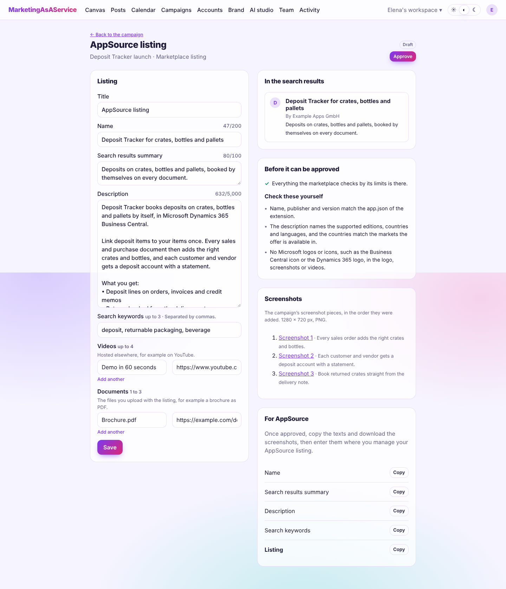
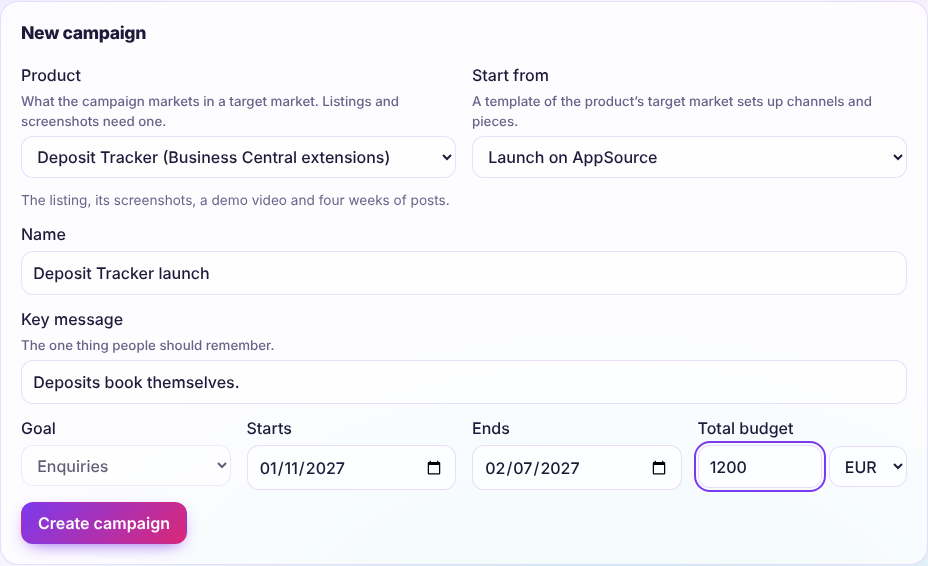

# MarketingApp4BusinessCentral

MarketingApp4BusinessCentral is MarketingAsAService set up for one job: marketing an extension for Microsoft Dynamics 365 Business Central. It is for the people who publish such an extension and have to get it found, tried and bought: the AppSource listing, the launch, every new version, and the numbers that show what worked.

It is a [target market](../markets.md): a plugin that a workspace installs, next to any other markets it sells in. The plugin holds everything that is particular to Business Central and AppSource (the profile fields, the listing's limits, Microsoft's rules, the templates, the AI guidance). The tools that use it are the same for every market and build on what is already there: the [brand kit](index.md#brand-kit), [campaigns](index.md#campaigns) with their approval, posts, ads and the [AI studio](ai-studio.md).

## Getting started

1. **Brand → Target markets → Install** next to *Business Central extensions* (owners and admins).
2. **Add product: Business Central extension** and fill in its profile.
3. **Campaigns → New campaign**: pick the product and *Launch on AppSource*. The campaign comes with the listing, three screenshots, a demo spot and a search ad as drafts.
4. Fill in the screenshots and the listing until their checks pass, then approve them.
5. Copy the texts and download the screenshots into Partner Center. Enter the marketplace's numbers in the campaign's results.

| | What you get |
|---|---|
| **Extension profile** | What the extension does, who it is for, what it can do, where it runs, and its links. Every listing, post and draft builds on it. |
| **AppSource listing** | The listing as a piece of a campaign: its texts with Microsoft's limits, keywords, videos and documents, checked before approval, then copied into Partner Center. |
| **Listing screenshots** | A capture of your extension becomes a 1280 × 720 PNG with a headline and a caption in the brand's colors. |
| **Campaign templates** | Launch on AppSource, a new version, ready for the release wave, an event, a customer story. |
| **Drafts by the AI studio** | Listing texts, and every other draft, written from the extension's profile and Microsoft's rules. |
| **Results** | Visits to the listing, installs and leads per day in the campaign's results, next to ads and posts. |

The pictures below are captures of the app, with an example extension.

### The extension profile

A workspace can hold several extensions, since a publisher often has more than one. A campaign belongs to one of them: pick it in the campaign's plan, or when you start the campaign.

Every product has the common fields of a profile. The Business Central market adds publisher, version, editions and the AppSource link.

- **The extension:** name, publisher and version (the same as in the app's `app.json`, because the listing has to match), and the AppSource link
- **What it does** and **who it is for:** the business and the person who uses it every day
- **What it can do:** up to eight things, one per line, the most important first
- **Where it runs:** editions (Essentials, Premium), countries, languages, and the price
- **Links:** help, privacy policy, support, demo video

What it does, publisher, version and editions are needed before a listing can be approved.

### The AppSource listing

The listing is a piece like an ad or a flyer: it starts as a draft, an owner or admin approves it, and changing it sends it back to draft. Its channel is **Marketplace listing**. The editor counts characters while you type; *Before it can be approved* lists what is still missing, and approval is refused until nothing is.

| Field | Microsoft's rule | Checked here |
|---|---|---|
| Name | up to 200 characters, no emojis | length |
| Search results summary | up to 100 characters | length |
| Description | up to 5,000 characters, simple HTML allowed | length |
| Search keywords | up to 3 | count |
| Screenshots | 3 to 5, PNG, 1280 × 720 pixels, each with a caption; no Microsoft logos or icons | count, caption, size |
| Videos | up to 4, hosted elsewhere (for example YouTube), each with a 1280 × 720 PNG thumbnail | count |
| Documents | 1 to 3 PDFs | count |
| Logo | PNG, from 216 × 216 to 350 × 350 pixels | no, entered in Partner Center |
| Categories and industries | a primary and a secondary category, up to 2 industries | no, entered in Partner Center |

These are Microsoft's rules as documented in November 2026: [listing details](https://learn.microsoft.com/en-us/partner-center/marketplace-offers/dynamics-365-business-central-offer-listing), [marketing validation checklist](https://learn.microsoft.com/en-us/dynamics365/business-central/dev-itpro/developer/readiness/readiness-checklist-marketing) and [marketing artifacts](https://learn.microsoft.com/en-us/dynamics365/business-central/dev-itpro/developer/readiness/readiness-checklist-g-marketingartifacts-logo-video-docs-screenshots). They change; the texts, counts and screenshot size live in the market's file (`packages/core/src/markets/business-central.ts`) and get checked against these pages when they do.

What a computer cannot check is listed under *Check these yourself*: name, publisher and version match the extension's `app.json`; the description names the supported editions, countries and languages, matching the markets of the offer; no Microsoft logos or icons.

The listing's screenshots are the campaign's *Listing screenshot* pieces. People enter the approved listing in Partner Center themselves: *For AppSource* copies each text, or all of them at once. Microsoft then validates it, which takes its own time.

### Listing screenshots

Upload a capture of a page of your extension, write a headline and a caption, and pick a background from the brand kit: a gradient of the main and second color, the main color, dark or light. The preview is the picture itself; **Download PNG** saves it in the size AppSource asks for. A screenshot needs a capture and a caption before it can be approved. Leave out Microsoft's logos and icons in the capture: the checklist does not allow them.

The downloaded picture:

### Campaign templates

| Template | When | What it sets up |
|---|---|---|
| Launch on AppSource | The extension goes live | The listing, three screenshots, a 30-second demo spot, a search ad; six posts over four weeks |
| New version | A release with something people asked for | An updated listing and a screenshot of what is new; three posts over two weeks |
| Ready for the release wave | Every April and October, when Business Central's new version arrives | An updated listing; one post |
| Event | A conference or a webinar | A flyer for the booth; four posts over three weeks |
| Customer story | A customer agrees to be named | A social ad with the customer's quote; three posts over three weeks |

A template sets the goal and the channels, adds its pieces as drafts, and writes the planned posts into the campaign's notes: posts need connected accounts, so let the AI studio draft them, or write them in the composer. Everything can be changed or removed.

### Drafts by the AI studio

With the [AI studio](ai-studio.md) set up, a campaign with a product offers **Marketplace → Marketplace listing**: Claude drafts the listing's texts and keywords within the market's limits. Every draft of such a campaign, ads and posts included, is written from the product's profile and the market's guidance: the platform is called "Microsoft Dynamics 365 Business Central" the first time and "Business Central" after that, never "BC"; nothing suggests that Microsoft made or endorses the extension; and the marketplace's rules apply. Drafts need the same approval as any piece.

### Results

The campaign's results take the marketplace like any channel. For AppSource, reach counts visits to the listing, clicks count "Get it now", and leads count installs and contact requests; the results table says so under it. Enter them per day from Partner Center's reports.

## Decisions

| Decision | Why | Revisit when |
|---|---|---|
| A target market plugin, not an app of its own | Brand kit, campaigns, approval, posts, ads and the AI studio are all needed and already there; what is particular to Business Central fits in one file | It should be offered on its own |
| Several markets per workspace | A publisher can sell in more than one marketplace; another market is a file, not new code | — |
| Installed per workspace, none at first | A physio practice and a software publisher can share a server without seeing each other's tools | — |
| For any extension | The profile holds what differs between extensions; nothing is written for one product | — |
| The listing is prepared here and entered in Partner Center by a person | Submitting is rare, and Microsoft validates by hand anyway | Listings change often enough to pay for Partner Center's submission API |
| Screenshots are drawn in the browser | Exactly the size the market asks for, with the brand's colors, and no image library on the server | Pictures need fonts the browser does not have |
| Templates note the planned posts instead of creating them | Posts need connected accounts and real texts | Post drafts without accounts exist |
| Marketplace numbers by hand | They fit the results as they are | Partner Center's reporting can be read reliably |
| Microsoft's limits in one place, with their source | They change, and a wrong limit fails validation weeks later | — |

MarketingApp4BusinessCentral is not a Microsoft product. Microsoft, Dynamics 365, Business Central and AppSource are trademarks of the Microsoft group of companies.

## Where it lives

- `packages/core/src/markets/business-central.ts`: the market itself, as data
- `packages/core/src/market.ts`, `plugins.ts`: the target market format, its checks, `listingProblems`, and installing markets per workspace (see [target markets](../markets.md#for-developers))
- `packages/core/src/products.ts`: products and their profiles, and `checkListing`, which approval of a listing waits for
- `packages/core/src/templates.ts`: starting a campaign from a market's template
- `packages/core/src/campaigns.ts`, `marketing.ts`: the marketplace channel and the listing and screenshot pieces; `studio.ts`: the product in the AI studio's prompt and listing drafts
- `packages/db`: `products`, `campaigns.product_id`, and the piece kinds `listing` and `screenshot` (migration `0020_products`)
- `apps/web`: **Brand → Target markets** and the product pages (`app/(app)/brand/`), the listing and screenshot editors (`components/listing-editor.tsx`), the template picker; texts in `messages/markets.ts` and `messages/listing.ts`, in English and German

## Build order

0. [x] **Target market plugins.** The format with its checks, storage per workspace, and the built-in market `business-central`.
1. [x] **Markets and profiles in the app.** Install markets under Brand (built-in or from a file), owners and admins only; products with their profile; a campaign's product.
2. [x] **AppSource listing.** The channel and the piece with limits, checks and approval; copy the texts.
3. [x] **Listing screenshots.** Capture, headline, caption and background, drawn at 1280 × 720.
4. [x] **Campaign templates.**
5. [x] **Drafts by the AI studio.** Listing drafts, and the product and Microsoft's rules in every prompt.
6. [x] **Results.** The marketplace channel, with the market's meaning of reach, clicks and leads.
7. [ ] **Next.** Read the numbers from Partner Center's reports; post drafts from templates once posts can wait for accounts; the listing's logo and categories.
