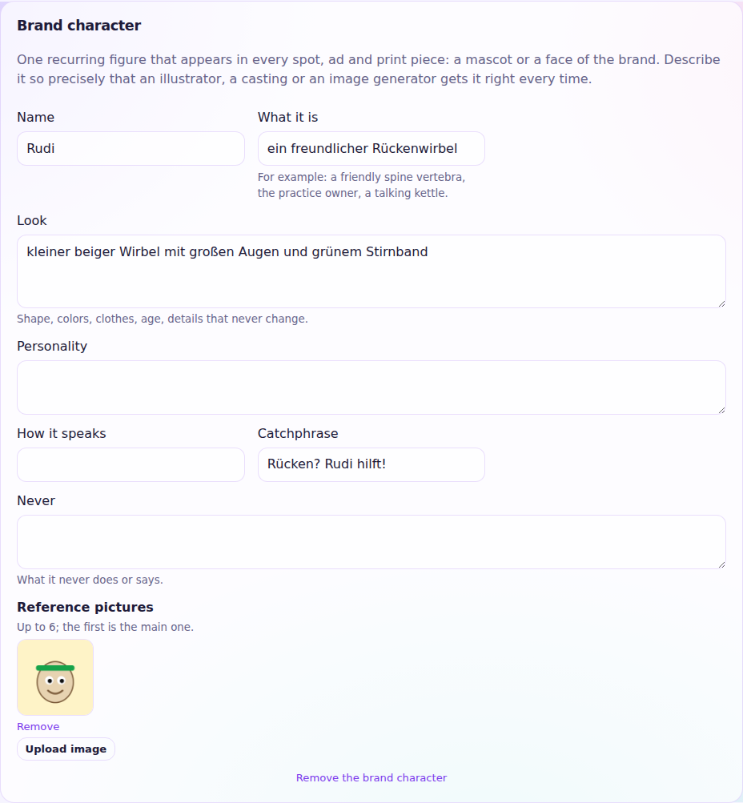
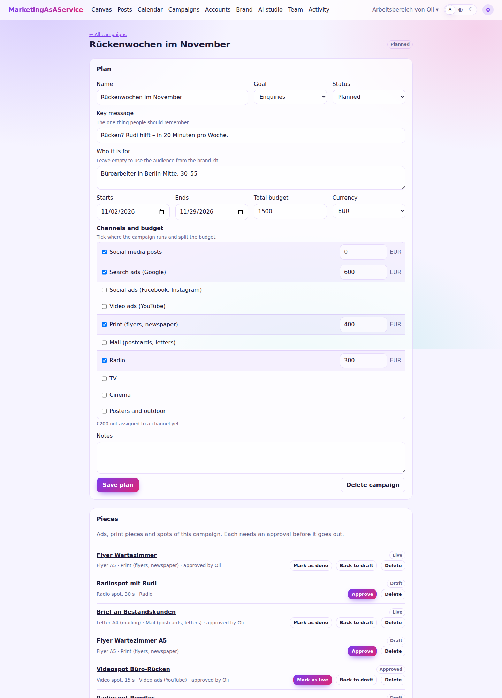

# Marketing

MarketingAsAService covers more than social media posts. A business's marketing runs in **campaigns**: one goal, one message and one budget across every channel it uses, from social posts and online ads to flyers, letters by post and radio spots. Every piece carries the same brand and the same **brand character**, so people recognize the business wherever they meet it.

| Channel | What you make here | Guide |
|---|---|---|
| Social media posts | Posts to 15 networks, planned on the calendar | [Networks](../networks/index.md) |
| Search ads (Google) | Responsive search ads with keywords | [Paid ads](ads.md) |
| Social ads (Facebook, Instagram) | Image ads with a button | [Paid ads](ads.md) |
| Video ads (YouTube) | Video ads from a spot of the campaign | [Paid ads](ads.md) |
| Print, posters, newspaper | Print-ready PDFs with bleed and CMYK colors | [Print and letters](print.md) |
| Mail | Postcards and letters, sent by post through Pingen | [Print and letters](print.md#send-letters-with-pingen) |
| Video, TV, cinema and radio | Spot scripts and a briefing PDF for production | [Spots](spots.md) |

An optional [AI studio](ai-studio.md) has Claude draft any of these for a campaign. It is separate: everything also works by hand.

## Brand kit

**Brand** in the navigation holds what every piece builds on:

- **Company:** name, tagline, what it does, audience, website and contact details (they appear on print pieces and letters)
- **How you sound:** tone of voice, what fits and what never does
- **How you look:** five colors, a typeface for print and the logo
- **The brand character** (optional)

Owners and admins edit the brand kit; everyone in the workspace sees it.

### The brand character

One recurring figure, such as a mascot or the face of the business, that appears in every spot, ad and print piece. Describe it precisely: name, what it is, look, personality, how it speaks, its catchphrase and what it never does, plus up to six reference pictures. The description goes into every production briefing and every AI draft, so an illustrator, a speaker or an image generator gets it right each time.

The tools check that the character is used. A spot script reminds you when the character does not appear or its catchphrase is missing. Print pieces show the character's main picture with its catchphrase.

## Campaigns

A campaign has:

- a **goal** (awareness, website visits, enquiries, sales or an event), a **key message** (the one thing people should remember) and an audience (empty means the brand kit's audience)
- a start and an end, a **total budget** and how it splits across the channels the campaign uses
- **pieces**: ads, print pieces and spots, each in a fixed format with the platform's or the printer's limits
- **posts**: social posts that belong to it. Start one from the campaign, or pick the campaign in the composer.
- **results** per channel: spend, reach, clicks, leads, sales and revenue

### Approval

Every piece starts as a *draft*. An owner or admin approves it. After that it can be marked *live* and later *done*. Nothing paid or printed goes out unapproved: ads launch, and letters are sent, only from approved pieces. Changing an approved piece sends it back to *draft*.

Editors write and change pieces and posts. Owners and admins approve, delete campaigns, connect ad accounts, start ads and send letters.

### Results

Enter numbers by hand for channels that report none, such as print or radio: the day, spend, reach, clicks, leads, sales and revenue. Ads from Google Ads and Meta Ads report their numbers on their own every hour. Letters sent through Pingen book their postage. The campaign then shows, per channel and in total, what was planned and spent, cost per lead and return on ad spend, and marks a channel that spends more than planned.
