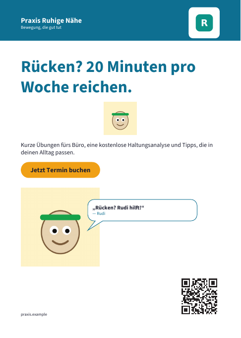

# Print and letters

Print pieces belong to a campaign. MarketingAsAService lays them out from the brand kit: colors, typeface, logo, contact details and the brand character with its catchphrase. You write the texts, pick a picture and download a print-ready PDF, or send letters by post through Pingen.

## Formats

| Format | Size (trim) | Channel | Notes |
|---|---|---|---|
| Flyer A6 | 105 × 148 mm | Print | |
| Flyer A5 | 148 × 210 mm | Print | |
| Poster A3 | 297 × 420 mm | Outdoor | |
| Poster A2 | 420 × 594 mm | Outdoor | |
| Newspaper ad | the size you booked | Print | Enter width and height in millimetres |
| Postcard A6 | 148 × 105 mm | Mail | Front with headline, picture and brand character; back with text, contact details, QR code and an address field |
| Letter A4 | 210 × 297 mm | Mail | DIN 5008 (form B) with the address in the window; can go out by post through Pingen |

## Editing a print piece

Open a campaign, add a piece of type *Print* and click its title. A print piece has:

- **Headline** (the subject for letters), **text** and a **call to action**, drawn as a button in the accent color.
- An optional **picture**. JPEG or PNG work best; WebP and GIF are converted when the [`sharp`](https://sharp.pixelplumbing.com) package is installed (it is in the web image, not in the worker image).
- A **QR code** to a link of your choice.
- Switches for the **brand character**, the **logo** and the **contact details** from the brand kit.

In letters and postcards, `{name}` stands for the recipient's name. Without a recipient (a print-shop PDF) it is left out.

The preview shows the PDF with a sample address. Under it, MarketingAsAService says when a picture is too coarse for its printed size (less than 150 dpi) or when the text had to be set smaller or cut to fit. Saving a piece sends it back to *draft*; an owner or admin approves it before it goes out.

## Print PDFs

**Download print PDF** gives a file you can upload to any print shop:

- 3 mm bleed on every side, with the trim and bleed boxes set
- **with crop marks**, if your print shop wants them
- embedded fonts: Source Sans 3 or Source Serif 4 (SIL Open Font License), whichever typeface the brand kit uses
- text and shapes in CMYK, converted straight from the brand colors without a color profile; pictures stay as uploaded

The conversion to CMYK is simple, so bright brand colors may print duller than on screen. Order a proof before a large run.

## Send letters with Pingen

[Pingen](https://www.pingen.com) prints, folds and posts letters from PDFs: in Switzerland, Germany and Austria, and abroad. MarketingAsAService sends each recipient their own letter, with their address in the window and their name wherever the text says `{name}`.

Like the [Zernio bridge](../bridge.md), Pingen is set up once per server by its admin, and letters are billed to that Pingen account.

1. Create an account at [pingen.com](https://www.pingen.com) and an organisation in it.
2. In Pingen, create API credentials for the *client credentials* grant ([Pingen API documentation](https://api.pingen.com/documentation)).
3. Set `PINGEN_CLIENT_ID` and `PINGEN_CLIENT_SECRET` and restart web and worker.

| Variable | What it does |
|---|---|
| `PINGEN_CLIENT_ID`, `PINGEN_CLIENT_SECRET` | Pingen API credentials; without them, letters can only be downloaded |
| `PINGEN_ORGANISATION_ID` | The organisation to send from (default: the account's first one) |
| `PINGEN_STAGING` | `true` uses Pingen's test environment (with its own account there): letters are checked but never printed or sent |
| `PINGEN_API_URL` | Another API address, for a fake server in tests |

To send a letter:

1. Approve the letter piece.
2. Paste the recipients, one per line, for example from a spreadsheet: name; street; postcode; town; country (optional two-letter code such as `DE`, `AT` or `CH`; `DE` when empty). Semicolons, tabs and commas all work, and a header line is skipped. Up to 1,000 recipients per mailing.
3. Choose fast or economy delivery and color or black and white, then **Check recipients and price**. Pingen's price calculator gives the total.
4. **Send**. The worker hands the letters to Pingen within a minute and follows them until they are sent. Letters Pingen cannot take (for example an address it cannot read) show as failed, with Pingen's reason.

Once every letter of a mailing is with Pingen, the mailing appears in the campaign's results: channel *Mail*, the number of letters as reach and Pingen's prices as spend (when Pingen bills in the campaign's currency).

**Privacy.** Recipients' addresses stay in MarketingAsAService until you delete the mailing (**Delete addresses**). Only write to customers and people who agreed to it, and sign Pingen's data processing agreement.

Postcards are not sent through Pingen, which only posts letters. Print them at a print shop that also posts them, or post them yourself.
