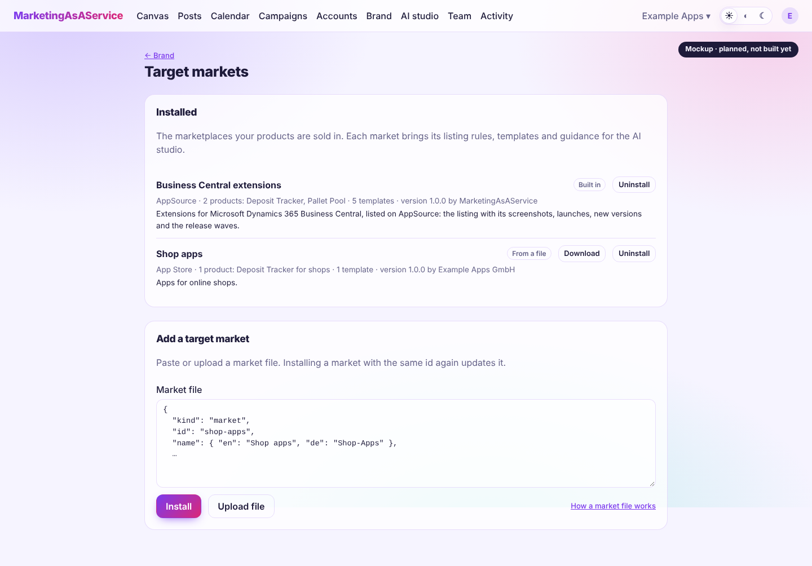

# Target markets

A **target market** is a plugin that sets MarketingAsAService up for one kind of product and the marketplace it is sold in. It says what is marketed, what its profile holds, the marketplace and the limits of a listing there, campaign templates, guidance for the AI studio, and what the result numbers count. A workspace can install several target markets, so one publisher can market an extension for Business Central and an app for online shops side by side.

Markets are plugins like [themes](themes.md): a JSON file, checked when it is installed, stored per workspace. Built-in markets ship with MarketingAsAService and update with it. A market is data only: it cannot run code or change how the app looks.

| Market | Product | Marketplace | Guide |
|---|---|---|---|
| **Business Central extensions** (`business-central`, built in) | An extension for Microsoft Dynamics 365 Business Central | AppSource | [MarketingApp4BusinessCentral](marketing/business-central.md) |

> **Status:** the format, its checks and the storage are built (`@maas/core/market`). Installing markets in the app, product profiles, listings and templates are not built yet; the [build order](marketing/business-central.md#build-order) says what comes next.

## Using target markets

- **Owners and admins install markets** under **Brand → Target markets**: a built-in one with one click, or their own from a file. New workspaces start without any, since most businesses do not sell in a marketplace.
- **Each product belongs to one market.** A workspace can hold several products per market, for example two Business Central extensions.
- **A campaign belongs to one product.** Its templates, listing, AI drafts and result labels come from the product's market.
- **Uninstalling a market** hides its tools; products and campaigns stay and come back when it is installed again.



## The market file

A market is a JSON file. Every text people see is given in English and German. This is a small, complete one:

```json
{
  "kind": "market",
  "id": "shop-apps",
  "name": { "en": "Shop apps", "de": "Shop-Apps" },
  "version": "1.0.0",
  "author": "Example Apps GmbH",
  "description": { "en": "Apps for online shops.", "de": "Apps für Onlineshops." },
  "product": {
    "name": { "en": "Shop app", "de": "Shop-App" },
    "fields": [
      {
        "id": "plans",
        "label": { "en": "Plans", "de": "Tarife" },
        "type": "choices",
        "options": [
          { "id": "basic", "label": { "en": "Basic", "de": "Basic" } },
          { "id": "plus", "label": { "en": "Plus", "de": "Plus" } }
        ],
        "required": true
      }
    ]
  },
  "marketplace": {
    "name": "App Store",
    "url": "https://apps.example.com",
    "listing": {
      "texts": [
        { "id": "name", "label": { "en": "Name", "de": "Name" }, "max": 30 },
        { "id": "tagline", "label": { "en": "Tagline", "de": "Slogan" }, "max": 80 },
        { "id": "description", "label": { "en": "Description", "de": "Beschreibung" }, "max": 2800, "multiline": true }
      ],
      "keywords": { "max": 5 },
      "screenshots": { "min": 1, "max": 6, "width": 1600, "height": 900 },
      "videos": { "max": 1 },
      "documents": { "max": 0 }
    },
    "rules": [{ "en": "The name does not repeat the shop system's name.", "de": "Der Name wiederholt nicht den Namen des Shopsystems." }]
  },
  "templates": [
    {
      "id": "launch",
      "name": { "en": "Launch", "de": "Start" },
      "description": { "en": "The listing and two weeks of posts.", "de": "Der Eintrag und zwei Wochen Posts." },
      "goal": "leads",
      "channels": ["social", "search_ads"],
      "pieces": [
        { "kind": "listing", "title": { "en": "Listing", "de": "Eintrag" } },
        { "kind": "screenshot", "title": { "en": "Screenshot", "de": "Screenshot" } },
        { "kind": "ad", "format": "search", "title": { "en": "Search ad", "de": "Suchanzeige" } }
      ],
      "posts": 4,
      "weeks": 2
    }
  ],
  "studio": { "en": "Name the shop system correctly.", "de": "Nenne das Shopsystem korrekt." },
  "results": {
    "reach": { "en": "Visits to the listing", "de": "Besuche des Eintrags" },
    "clicks": { "en": "Installs started", "de": "Begonnene Installationen" },
    "leads": { "en": "Installs", "de": "Installationen" }
  }
}
```

### What goes in it

| Field | Required | What it is |
|---|---|---|
| `kind` | yes | Always `"market"` |
| `id` | yes | Lowercase letters, digits and dashes. Unique among all plugins of a workspace, themes included |
| `name`, `description` | yes | Shown where markets are listed |
| `version`, `author` | no | Defaults `"1.0.0"` and `"Unknown"` |
| `product.name` | yes | What one product of this market is called, e.g. "Business Central extension" |
| `product.fields` | no | Fields the product profile adds (see below) |
| `marketplace` | yes | Where the product is sold, and its listing (see below) |
| `templates` | no | Campaign templates (see below) |
| `studio` | yes | Guidance the AI studio follows for every draft of this market, such as how the platform has to be named |
| `results.reach`, `.clicks`, `.leads` | yes | What these numbers count for the marketplace, shown in the campaign's results |

Texts are objects with `en` and `de`. A plain string is refused, so nothing shows up untranslated.

### Product fields

Every product already has a name, what it does, who it is for, what it can do, countries, languages, a price, and links to help, privacy policy, support and a video. A market adds what only its products have:

| Field | What it is |
|---|---|
| `id` | Lowercase letters, digits and `_`, starting with a letter. Must not be one of the common fields |
| `label`, `hint` | Shown at the field; `hint` is optional |
| `type` | `text` (default), `choice` (one option) or `choices` (several) |
| `options` | For `choice` and `choices`: 2 to 30 options with `id` and `label` |
| `required` | `true` if a listing cannot be approved while it is empty |

### Marketplace and listing

| Field | What it is |
|---|---|
| `name` | The marketplace's name, the same in every language, e.g. "AppSource" |
| `url` | Its `https://` address |
| `listing.texts` | The listing's text fields, 1 to 30: `id`, `label`, `max` characters, `required` (default `true`), `multiline` |
| `listing.keywords`, `.videos`, `.documents` | How many: `min` (default 0) and `max` |
| `listing.screenshots` | How many (`min`, `max`) and their size in pixels (`width`, `height`); they are rendered as PNG |
| `rules` | Up to 30 checks the marketplace makes that a computer cannot, shown before approval and given to the AI studio |

Before a listing can be approved, MarketingAsAService checks every limit: required texts filled in, texts within their length, the number of keywords, screenshots, videos and documents, and a caption on every screenshot (`listingProblems` in `@maas/core/market`).

### Templates

A template fills in a new campaign. Every template uses the market's marketplace; `channels` adds others.

| Field | What it is |
|---|---|
| `id`, `name`, `description` | Shown when a campaign is started |
| `goal` | `awareness` (default), `traffic`, `leads`, `sales` or `event` |
| `channels` | Any of the platform's channels: `social`, `search_ads`, `social_ads`, `video_ads`, `print`, `mail`, `radio`, `tv`, `cinema`, `outdoor` |
| `pieces` | `listing`, `screenshot`, or a piece of the platform's kinds with its format, e.g. `{ "kind": "ad", "format": "search" }` |
| `posts`, `weeks` | How many post drafts, spread over how many weeks (defaults 0 and 4) |

### Rules

- A file is at most 200 KB.
- Ids are unique: product fields, options, listing texts and templates each use an id once.
- Installing a market with an id that is already installed updates it. An id used by a built-in plugin or by a theme is refused.
- A stored market that no longer passes the checks (after an update of MarketingAsAService) is left out until it is installed again.

## For developers

- Format, checks and the listing check: `packages/core/src/market.ts` (browser-safe, also exported as `@maas/core/market`)
- Built-in markets: `packages/core/src/markets/`; add one there and to `builtinMarkets`. Its source of every limit goes in the file's comment.
- Storage: the `plugins` table with `kind = 'market'`; `listMarkets`, `installBuiltinMarket`, `installMarket` and `uninstallMarket` in `packages/core/src/plugins.ts`
- Error messages in English and German: `marketMessages` in `packages/core/src/messages.ts`
